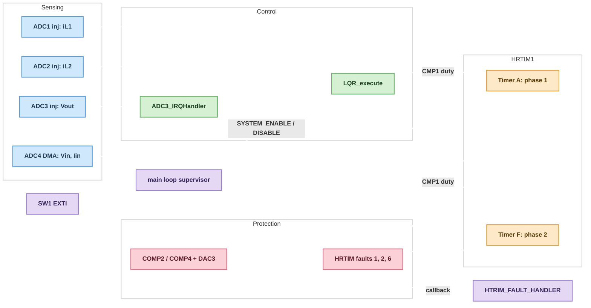
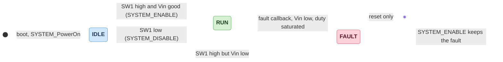

# InterleavedBuck Firmware

**Firmware for a 2-phase interleaved buck converter on an STM32G474RE, with an LQR-based PWM controller.**

## Overview

STM32CubeIDE project for the STM32G474RETx. The project is named `LQR_2PhaseBuck_RE`. The control code is in `LQR_PWM_ct.c` and `LQR_PWM_ct.h`.

## Specifications

| Parameter | Specification |
|---|---|
| MCU | STM32G474RETx |
| Toolchain | STM32CubeIDE (CubeMX `.ioc` project) |

*Specifications describe design targets unless explicitly identified as measured or verified results.*

## Getting Started

1. Open `LQR_2PhaseBuck_RE` in STM32CubeIDE (File > Open Projects from File System).
2. Build the Debug or Release configuration.
3. Flash with an ST-LINK debugger.

## Architecture

The firmware is a bare-metal, interrupt-driven design on the STM32 HAL. A fast control loop runs in the ADC3 interrupt. A slow supervisor runs in the `main` loop and in a button interrupt.

### Block Diagram



### Components

| Component | File | Role |
|---|---|---|
| Entry and supervisor | `Core/Src/main.c` | Init, state machine, input voltage check, efficiency calculation, fault handler, button callback. |
| LQR controller | `Core/Src/LQR_PWM_ct.c`, `Core/Inc/LQR_PWM_ct.h` | Control law, soft start, duty limits, start and stop of the PWM. |
| Interrupt handlers | `Core/Src/stm32g4xx_it.c` | `ADC3_IRQHandler` runs the control loop. Also DMA1 CH1, EXTI15_10, HRTIM fault and HardFault handlers. |
| Peripheral init | `Core/Src/main.c` (CubeMX generated), `LQR_2PhaseBuck_RE.ioc` | ADC1 to ADC4, HRTIM1, COMP2, COMP4, DAC3, DMA, GPIO. |
| Startup and memory | `Core/Startup/startup_stm32g474retx.s`, `STM32G474RETX_FLASH.ld`, `STM32G474RETX_RAM.ld` | Vector table and linker scripts. The linker scripts define the CCM RAM sections. |

### Control Loop

`LQR_execute()` runs once per ADC3 injected end-of-conversion interrupt.

1. Read the raw injected results: `ADC1->JDR1` (iL1), `ADC2->JDR1` (iL2), `ADC3->JDR1` (Vout).
2. Convert to amps and volts with the gain and offset macros. Apply a first-order IIR filter (coefficient 0.611).
3. Compute the state deltas: `ΔiL1`, `ΔiL2`, `ΔVo` and the previous duty deltas `Δu1`, `Δu2`.
4. Compute two error terms: `e_vo = Vref - Vo` and `e_iL = Iref - (iL1 - iL2)`. The second term balances the two phases.
5. Apply the gain matrices `K1` and `K2` (7 gains each, one row per phase) to get `Δu1` and `Δu2`. Add them to the previous duty. This is an incremental (velocity form) LQR with integral action.
6. Clamp the duty to 5 % to 93 % and write it to `CMP1` of HRTIM Timer A (phase 1) and Timer F (phase 2).
7. Shift the state history for the next sample.

Other details:
- `VREF` is 12 V and `IREF` is 0 A (set by macros in `LQR_PWM_ct.c`).
- Soft start ramps the reference with a first-order filter (comment in code: 5 ms settling). It ends when the reference reaches 99.99 % of `VREF`.
- The gains `K1_*` and `K2_*` are `const float` values. The weights `Q` and `R` used to compute them are in the comments above them.
- Timing pins: `PD2` and `PC12` (`ISR_Pin`) are set at the start of the ISR and cleared at the end, so the execution time can be measured with a scope.

### PWM and Timing

| Item | Value | Source |
|---|---|---|
| System clock | 170 MHz (HSE 24 MHz, PLLM 6, PLLN 85, PLLR 2) | `SystemClock_Config`, `HSE_VALUE` |
| HRTIM timer clock | 170 MHz x 32 | `PRESCALERRATIO_MUL32` |
| Master timer period | 27200 ticks | `MX_HRTIM1_Init` |
| Timer A and F | Up-down mode, period 13600 ticks, preload and dead time enabled | `MX_HRTIM1_Init` |
| Switching frequency | About 200 kHz (calculated from the values above, `NOT_VERIFIED` on hardware) | calculated |
| ADC trigger | HRTIM ADC trigger 2, source: master period | `MX_HRTIM1_Init` |
| Duty to ticks | `CMP1 = 13600 x duty` | `TO_DUTY` |

Timer E (up mode, period 30000) sets output `TE1` on the master period and resets it on its own `CMP1`. Its purpose is not documented in the code. `NOT_VERIFIED`.

### System State Machine

`System_StateTypeDef` has three states: `STATE_IDLE`, `STATE_RUN` and `STATE_FAULT`.



- **Boot:** `init_CCMRAM()` copies the CCM RAM sections from flash. Then the clock, peripherals, ADC calibration and ADC starts run. `SYSTEM_PowerOn()` blinks the fault LED once, then reads SW1.
- **Enable:** `SYSTEM_ENABLE()` checks the input voltage. If good, it sets `EN_CH1` and `EN_CH2`, sets the state to RUN and calls `LQR_Init()`. `LQR_Init()` resets the controller, starts the HRTIM counters and outputs, and enables the ADC3 interrupt.
- **Disable:** `SYSTEM_DISABLE()` clears the enable pins and calls `LQR_Stop()`.
- **Fault:** `HTRIM_FAULT_HANDLER()` sets the state to FAULT, disables both phases, calls `LQR_FaultStop()` and lights the fault LED. No code path leaves FAULT except a reset. `NOT_VERIFIED` on hardware.
- **Supervisor:** The `main` loop checks the input voltage every 100 ms and calculates efficiency every 1000 ms.

### Protection

| Protection | Mechanism |
|---|---|
| Phase overcurrent | COMP2 (phase 1) and COMP4 (phase 2) compare the phase current with DAC3 CH2. The threshold `maxCurrentComp = 2792` is about 12 A (comment in code). Their outputs feed HRTIM faults 1 and 2. |
| External fault | HRTIM fault 6 (digital input). |
| System fault | `HAL_HRTIM_SystemFaultCallback`. |
| Input undervoltage | `Vin` raw value below 1911 counts (about 14 V by the code comment and gain). Stops the converter in RUN, blocks start in IDLE. |
| Duty saturation | If the duty stays at the 93 % limit for 1000 samples in total, `HTRIM_FAULT_HANDLER()` is called. |
| CPU fault | `HardFault_Handler` turns off the LEDs and blinks the fault LED. |

### Hardware Mapping

| Signal | Pin |
|---|---|
| Phase 1 high side and low side PWM | PA8, PA9 |
| Phase 2 high side and low side PWM | PC6, PC7 |
| Phase 1 and 2 enable | PA10 (`EN_CH1`), PC9 (`EN_CH2`) |
| iL1 sense (ADC1) and COMP2 input | PA3, PA7 |
| iL2 sense (ADC2) and COMP4 input | PC4, PB0 |
| Vout sense (ADC3) | PB1 |
| Vin and Iin sense (ADC4, DMA) | PB12, PB14 |
| Start/stop switch (EXTI, both edges) | PA15 |
| LEDs: idle, run, fault, user | PC0, PC1, PC2, PC3 |

### Design Considerations

- **Hot path in CCM RAM:** `LQR_execute`, `ADC3_IRQHandler`, the gains and the controller state are placed in `.ccmram.*` sections. `init_CCMRAM()` must run first in `main`.
- **Direct register access:** The ISR reads `JDR1` and writes HRTIM `CMP1` directly, not through HAL, to keep the loop short.
- **Simultaneous sampling:** ADC1 and ADC2 run in dual injected simultaneous mode (ADC2 is the slave, started first). ADC3 is independent and raises the control interrupt.
- **Reset before run:** `LQR_Reset()` must run before `LQR_execute()`. `LQR_Init()` does this.
- **Float math in the ISR:** The loop uses single-precision float on the Cortex-M4 FPU.
- Fixed values such as `VREF`, the current offset and the ADC gains are compile-time macros. Changing them needs a rebuild.

## Repository Structure

```text
InterleavedBuck_Firmware/
├── .gitignore
├── LICENSE
├── README.md
└── LQR_2PhaseBuck_RE/
    ├── Core/
    │   ├── Inc/            (main.h, LQR_PWM_ct.h, HAL config and IRQ headers)
    │   ├── Src/            (main.c, LQR_PWM_ct.c, HAL MSP, IRQ, system files)
    │   └── Startup/        (startup_stm32g474retx.s)
    ├── Drivers/            (CMSIS and STM32G4xx HAL driver)
    ├── LQR_2PhaseBuck_RE.ioc
    ├── STM32G474RETX_FLASH.ld
    └── STM32G474RETX_RAM.ld
```

## License

This project is licensed under the GNU General Public License v3.0. See [LICENSE](LICENSE).

Third-party code under `LQR_2PhaseBuck_RE/Drivers/` carries its own license (see the `LICENSE.txt` files in that folder).
